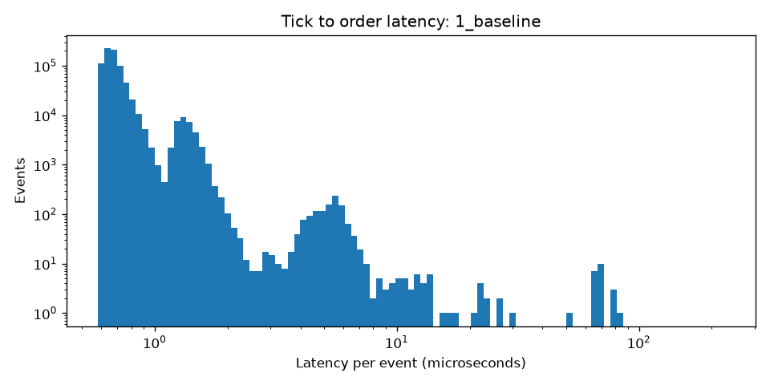
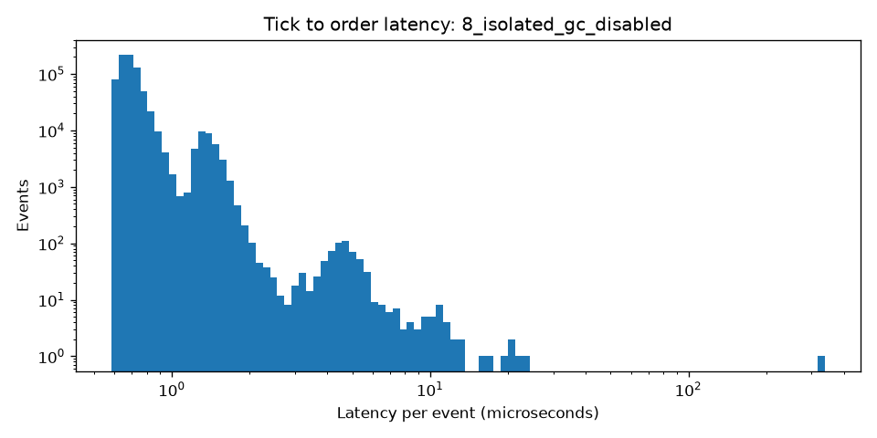
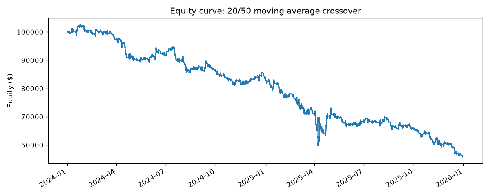

# Latency Backtester

Event driven Python backtesting engine with a Linux low latency tuning study. Replays 779,968 one minute bars (SPY, QQQ, AAPL, MSFT, Jan 2024 to Dec 2025, regular trading hours) through a strategy, portfolio, and simulated execution loop at about 960,000 events per second, and measures tick to order latency for every event.

## Results: tick to order latency

Each row is the median of 5 full replays (first 10,000 events discarded as warm up), measured on a GCP c3-standard-4 VM running Ubuntu 24.04 LTS.

| Step                                           | p50 (us) | p99 (us) | p99.9 (us) | Max (us) | Events/sec |

| 1. Baseline (no tuning)                        | 0.66 | 1.48 | 5.06 | 225.1 | 961,615 |
| 2. tuned latency-performance profile           | 0.67 | 1.48 | 4.78 | 204.1 | 960,976 |
| 3. CPU isolation + IRQ affinity + core pinning | 0.68 | 1.48 | 2.16 | 206.6 | 957,355 |
| 3 (rerun)                                      | 0.67 | 1.45 | 2.16 | 227.3 | 957,775 |
| 4. + SCHED_FIFO real time scheduling (rerun)   | 0.68 | 1.46 | 2.14 | 212.1 | 957,646 |
| **Best: isolation + pinning + GC disabled**    | **0.67** | **1.44** | **2.05** | **21.6** | **966,858** |

**Findings**

- **CPU isolation cut p99.9 latency 59%** (5.06 to 2.05 us). Removing the core from the general scheduler and routing interrupts elsewhere eliminates most scheduling jitter.
- **Disabling Python's garbage collector cut worst case latency 90%** (225.1 to 21.6 us). GC pauses were the source of the largest spikes.
- **p50 did not move.** Tuning removes jitter in the tail; it does not speed up the typical event.
- **The tuned profile had little effect on a VM**, where the hypervisor controls physical CPU power states.
- **SCHED_FIFO added nothing on an already isolated core**, since nothing else competes for it. A first FIFO run showed a worse p99.9 (4.82 us); a rerun gave 2.14 us, so that result was transient noise, not a real effect.

## What each tuning step does

- **tuned latency-performance:** keeps CPUs in high performance states and out of deep sleep states that add wake up delay
- **isolcpus, nohz_full, rcu_nocbs:** removes one physical core (both hyperthreads) from the general scheduler, stops its periodic timer tick, and moves RCU callbacks off it
- **IRQ affinity:** routes hardware interrupts to the housekeeping CPUs only
- **taskset:** pins the process to one isolated hyperthread, leaving its sibling idle so nothing shares the core
- **SCHED_FIFO (chrt):** real time scheduling priority
- **GC disabled:** `gc.freeze()` and `gc.disable()` before the hot loop remove garbage collection pauses

## Architecture

    MarketEvent -> SimulatedExecution (fill queued order at this bar's open)
                -> Portfolio (update prices)
                -> MovingAverageCross (O(1) running sums)
                -> SignalEvent -> Portfolio -> OrderEvent -> queued for next bar

Orders always fill on the next bar's open, which prevents look ahead bias. Four unit tests cover the next bar fill rule, cash accounting, metrics, and an independent vectorized pandas model that must produce exactly the same trades as the event engine.

## Backtest: 20/50 moving average crossover on 1 minute bars

Costs modeled: 1 basis point slippage per fill and $0.005 per share commission. $100,000 starting capital split equally across the four symbols.

| Total return | Sharpe | Max drawdown | Fills  | Period |
| -44.24%      | -1.66  | -45.69%      | 17,535 | 1.99 years |

**Where the loss comes from**

| Gross P&L before costs | Slippage | Commission | Total costs | Net P&L |
| +$5,053                | $43,458  | $5,836     | $49,295     | -$44,241 |

The signal is roughly flat before costs (+5.1% over two years). Trading costs, mostly slippage, turn it into a 44% loss. This is the expected result for a naive high frequency signal and shows why realistic cost modeling matters: a backtest without it would have looked marginally profitable.

The strategy is deliberately simple; the focus of this project is the engine design and the latency engineering.

## Reproduce

    pip install -r requirements.txt
    export APCA_API_KEY_ID=... APCA_API_SECRET_KEY=...
    python scripts/fetch_data.py
    python -m pytest -v
    python run_backtest.py
    python -m bench.bench --label 1_baseline
    sudo ./scripts/tune_boot.sh 1,3 && sudo reboot      # isolate one core (both hyperthreads)
    sudo ./scripts/tune_runtime.sh 0,2                   # tuned profile + IRQs to housekeeping CPUs
    taskset -c 1 python -m bench.bench --label 8_isolated_gc_disabled --no-gc
    python -m bench.report

Use `cat /sys/devices/system/cpu/cpu*/topology/thread_siblings_list | sort -u` to find the hyperthread pairs on your machine; isolate a pair that does not include CPU 0.

## Stack

Python, NumPy, pandas, pytest, matplotlib, Alpaca market data API, Linux (Ubuntu 24.04), GCP Compute Engine
